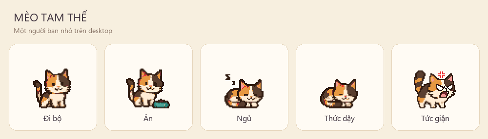

# Mèo cho ban gai choi dua

Viết bằng **Python 3.14 + PySide6**, dành cho Windows 10/11 64-bit. 



## Mở nhanh bản EXE

Mở **`dist\DesktopCat.exe`** bằng cách nhấp đúp. Không cần cài Python; không cần chép thư mục ảnh đi kèm. EXE một tệp tự giải nén tài nguyên lúc khởi động nên lần mở đầu có thể mất vài giây.


## Chạy mã Python

Mở PowerShell trong thư mục dự án:

```powershell
py -3.14 -m venv .venv
.\.venv\Scripts\python.exe -m pip install -r requirements.txt
.\.venv\Scripts\python.exe main.py
```

Không cần kích hoạt môi trường ảo. `PySide6_Essentials` cung cấp các module PySide6 cần dùng, không cài thêm trình duyệt WebEngine.

## Chỉnh hành vi và hình ảnh

- `desktop_cat/settings.py`: tốc độ đi (40 pixel logic/giây), thời gian ăn/ngủ/giận, tỉ lệ hiển thị (mặc định ×2).
- `desktop_cat/assets/manifest.json`: danh sách PNG theo thứ tự phát, fps và cờ lặp. Thời gian thức dậy được tính từ số khung và fps.
- `desktop_cat/assets/<trạng thái>/00.png`, `01.png`…: hình nền trong suốt 64 × 64, mèo hướng sang phải; chương trình tự lật ngang để đi trái.

Giữ chân/bát ăn trong hàng pixel cuối cùng `y=59`, tương ứng `ground_y=60` trong manifest; tránh vẽ vào bốn hàng dưới cùng. Điểm đặt chân chung này giữ mèo ngay trên taskbar. Giữ tỉ lệ phóng là số nguyên để pixel rõ. Tọa độ giao diện dùng đơn vị logic của Qt để thích ứng DPI Windows.

Bộ hình tam thể được tạo theo hai ảnh mẫu và lưu trong tools/calico-sheet.png. Pillow tách khung, bỏ nền trong suốt thừa và căn chân mèo trước khi xuất PNG. Để dựng lại ảnh, icon và bản xem trước:

```powershell
.\.venv\Scripts\python.exe -m pip install -r requirements-dev.txt
.\.venv\Scripts\python.exe tools\generate_assets.py
```

**Dựng lại sẽ ghi đè các PNG và manifest đã chỉnh thủ công.** Xem toàn bộ 30 khung tại `previews/contact_sheet.png`; xem hoạt ảnh tại `previews/preview.gif`.

## Kiểm thử và đóng gói

```powershell
.\.venv\Scripts\python.exe -m pip install -r requirements-dev.txt
.\.venv\Scripts\python.exe -m pytest -q
.\build.ps1
```

Nếu chính sách máy không cho chạy script PowerShell, chạy trực tiếp lệnh tương đương:

```powershell
.\.venv\Scripts\python.exe tools\build_exe.py
```

Kết quả là `dist/DesktopCat.exe`. Cần build trên Windows để tạo EXE Windows. Bản EXE dùng ảnh và cấu hình tại thời điểm build; chỉnh mã/ảnh xong phải build lại. Bộ dependency phát triển được khóa phiên bản trong `requirements-dev.txt`.

Script build cô lập đường dẫn tìm DLL để không lấy nhầm ICU từ Poppler/Conda hoặc công cụ khác trên máy. Sau build, script chép riêng EXE sang thư mục tạm và kiểm tra khởi động/tự thoát; lỗi chạy EXE sẽ làm cả lệnh build thất bại.

Kiểm thử tự động gồm máy trạng thái, click khi ngủ, click liên tục, phân biệt kéo/click, dừng thời gian, mép màn hình, ảnh và vùng nhận chuột. Có thể chạy thử khởi động và tự thoát bằng `main.py --smoke-test` hoặc `DesktopCat.exe --smoke-test`.

Để kiểm tra hiển thị dưới các tỉ lệ Qt mà không đổi cài đặt Windows:

```powershell
$env:QT_SCALE_FACTOR = '1.25' # Thử lần lượt 1, 1.25, 1.5
.\.venv\Scripts\python.exe main.py
Remove-Item Env:\QT_SCALE_FACTOR
```

Đây là mô phỏng tỉ lệ Qt, không thay thế hoàn toàn kiểm tra thực tế bằng cài đặt DPI Windows.

Cũng có thể chạy `tools/verify_desktop.py` với từng giá trị `QT_SCALE_FACTOR`: công cụ kiểm tra trực tiếp style cửa sổ Windows, vùng chuột xuyên qua, click/kéo, menu, mép màn hình và lưu ảnh render tại `previews/native/`.

## Cấu trúc

```text
main.py                  Điểm khởi chạy, xử lý lỗi
desktop_cat/
  settings.py            Các thông số mặc định
  behavior.py            Máy trạng thái và di chuyển, độc lập giao diện
  animation.py           Nạp bộ ảnh, chọn khung, lật ngang
  window.py              Cửa sổ, chuột, timer, menu, khay hệ thống
  assets/                30 PNG, manifest, icon
tools/generate_assets.py Công cụ dựng pixel art và bản xem trước
tests/                   Kiểm thử logic và tích hợp Qt
build.ps1                Gọi quy trình build và kiểm tra EXE
tools/build_exe.py       Cô lập môi trường DLL, build, chạy thử bản độc lập
previews/                Ảnh tĩnh, GIF và toàn bộ khung
```

Nếu lỗi khởi động, hộp thoại chỉ ra nơi lưu nhật ký trong thư mục dữ liệu cục bộ `DesktopCat` của tài khoản Windows. Lỗi nạp DLL trước khi Qt khởi động được lưu tại `%LOCALAPPDATA%/DesktopCat/startup-error.log`. Phần mềm dùng Qt/PySide6 và các thư viện bên thứ ba; tham khảo giấy phép đi kèm các gói khi phân phối lại.
